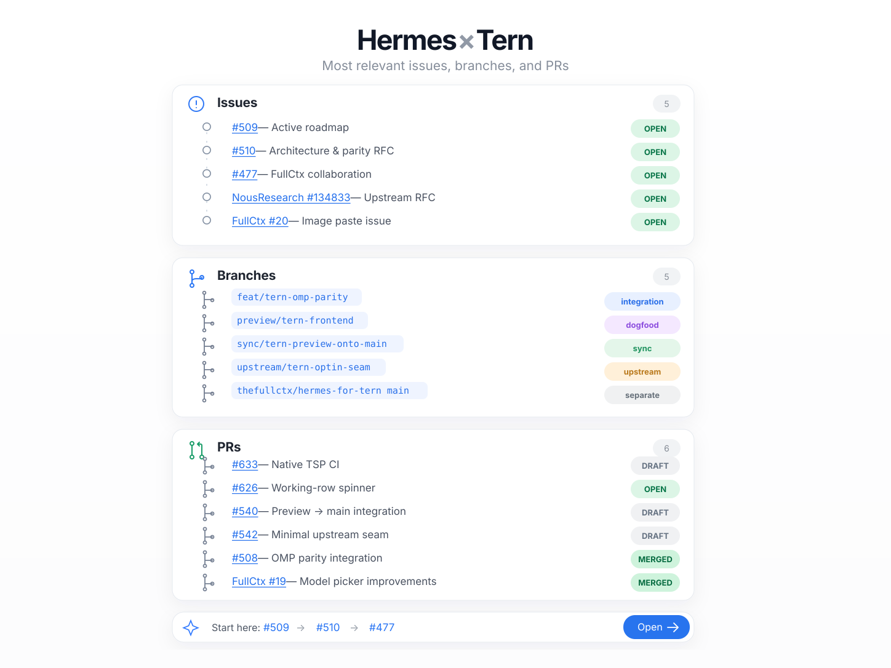

# Hermes × Tern — shareable project overview

**Source image:** [Open full-size SVG](./assets/hermes-tern-overview.svg) · [GitHub Pages version](https://kvnloo.github.io/hermes-maintainer/docs/hermes-tern-overview.html) *(available after deployment from main)*

## Start here

- [#509 — active roadmap](https://github.com/kvnloo/hermes-agent/issues/509)
- [#510 — architecture and parity RFC](https://github.com/kvnloo/hermes-agent/issues/510)
- [#477 — thefullctx collaboration](https://github.com/kvnloo/hermes-agent/issues/477)
- [#134833 — Hermes upstream RFC](https://github.com/NousResearch/hermes-agent/issues/134833)

**Snapshot:** October 20, 2026. PR states shown in the image are dated; use GitHub for live status.

**Attribution:** Hermes by NousResearch contributors; Tern / Surface Protocol and OMP-native interaction patterns by Can Bölük / Stencil Labs; distinct FullCtx frontend by thefullctx contributors. The graphic depicts repo navigation and is not a claim of authorship over the linked projects.
